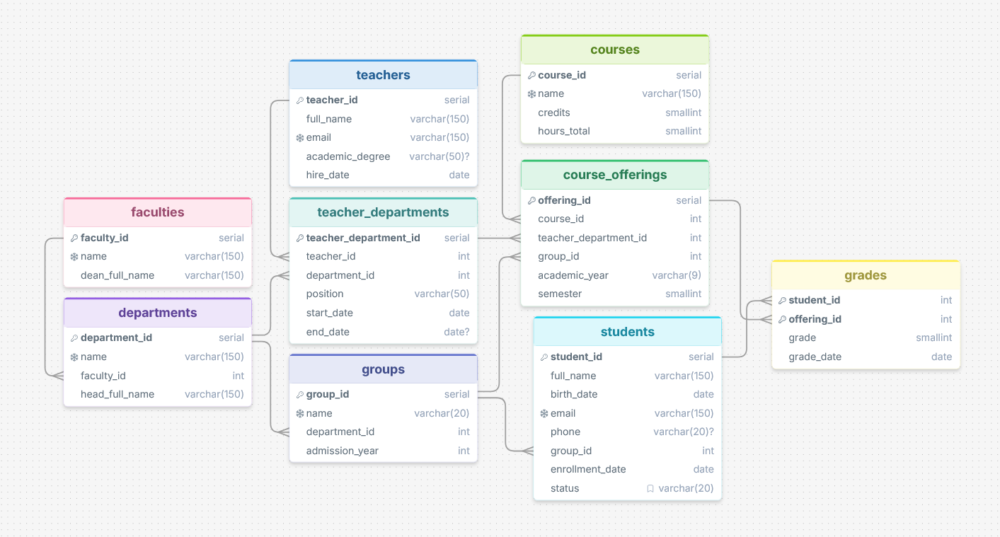

# Лабораторная работа №2

### Вариант 3
Информационная система университета.  
#### Предметная область
Университет состоит из факультетов, на каждом из которых работает несколько кафедр. Кафедра готовит студентов по учебным группам и в ней числятся преподаватели. Каждая кафедра предлагает дисциплины, которые в конкретном семестре и учебном году читаются конкретной группе конкретным преподавателем («предложение дисциплины», offering). По итогам обучения студент получает оценку за конкретное предложение дисциплины.  

### ER-диаграмма

### Запросы

`schema.sql` – создание БД;  

---

`data.sql` – наполнение тестовыми данными;  

---

`data_change.sql` содержит:
- Вставка новых данных с использованием `INSERT`;
- Изменение одной записи с использованием `UPDATE`;
- Массовое изменение с использованием `UPDATE`;
- Демонстрация корректного и некорректного удаления с помощью `DELETE`;
- Демонстрация отмены изменений с помощью `ROLLBACK`.

---

`selects2.sql` содержит:
- Запрос 2.1.1. Ведомость: подробная информация об оценках 2025/2026 уч. года;
- Запрос 2.1.2 (LEFT JOIN). Действующие назначения преподавателей без учебной нагрузки, а также преподаватели, не назначенные ни на одну кафедру (Отсутствие связанных данных заменяется понятными подписями через COALESCE);
- Запрос 2.1.3. Действующие студенты, получившие в 2025/2026 уч. году оценку 3 или ниже на занятии, которое вёл преподаватель с чужой кафедры;
- Запрос 2.2.1. Количественные показатели по учебным группам;
- Запрос 2.2.2. Нагрузка и «строгость» преподавателей (HAVING). Оставляет преподавателей, выставивших не менее 6 оценок, чей средний балл не выше 4.0 или есть хотя бы одна двойка;
- Запрос 2.2.3. Сравнение 1-го и 2-го семестров 2025/2026 по факультетам. Условная агрегация даёт показатели обоих периодов в одной строке.

---

`selects3.sql` содержит:
- Запрос 3.1. Студенты, чей средний балл выше среднего по их группе. Подзапрос в FROM вычисляет средний балл каждой группы;
- Запрос 3.2. (EXISTS) Преподаватели, у которых хотя бы один студент получил неудовлетворительную оценку (2);
- Запрос 3.3. (NOT EXISTS) Действующие студенты, у которых нет ни одной оценки за 2025/2026 учебный год;
- Запрос 3.4. Коррелированный подзапрос. Студенты, у которых последняя полученная оценка ниже их собственного среднего балла (признак ухудшения успеваемости). Оба подзапроса зависят от текущего студента внешнего запроса.

---

`selects4.sql` содержит комплексный отчет с использованием CTE:  
Запрос вычисляет какие кафедры по итогам 2025/2026 учебного года отстают от среднего уровня своего факультета и насколько велика доля студентов с задолженностями (оценка 2) на этих кафедрах.  

Схема вычислений: Исходные данные -> Промежуточные показатели -> Агрегация -> Итоговый отчёт  

1. grade_facts (исходные данные)  
   Вход:  grades, students, groups, departments, course_offerings.  
   Действие: соединение таблиц, отбор оценок 2025/2026 уч. года.  
   Результат: одна строка на оценку с привязкой к студенту, группе,
              кафедре группы и факультету.
2. student_metrics (промежуточные показатели)  
   Вход:  grade_facts.  
   Действие: группировка по студенту.  
   Результат: у каждого студента средний балл, число оценок и признак
              задолженности (есть оценка 2).
3. department_metrics и faculty_metrics (агрегация)  
   Вход:  student_metrics.  
   Действие: группировка по кафедре и по факультету.  
   Результат: по кафедре – число студентов, средний балл, число студентов
              с задолженностью и их доля; по факультету  – средний балл.
4. Итоговый SELECT (отчёт)  
   Вход:  departments, faculties, department_metrics, faculty_metrics.  
   Действие: соединение (LEFT JOIN, чтобы кафедры без данных не терялись),
             отклонение от факультета, ранг, текстовый вывод по правилу CASE.  
   Результат: ранжированная таблица кафедр с оценкой «Требует внимания».
