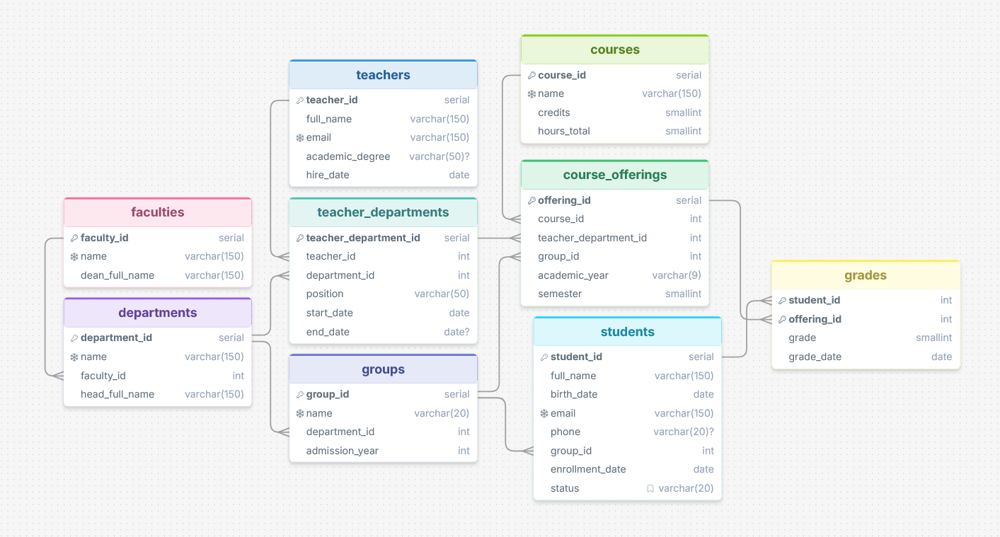

# Лабораторная работа №3

### Вариант 3
Информационная система университета.  
#### Предметная область
Университет состоит из факультетов, на каждом из которых работает несколько кафедр. Кафедра готовит студентов по учебным группам и в ней числятся преподаватели. Каждая кафедра предлагает дисциплины, которые в конкретном семестре и учебном году читаются конкретной группе конкретным преподавателем («предложение дисциплины», offering). По итогам обучения студент получает оценку за конкретное предложение дисциплины.  

### ER-диаграмма

### Запросы

`schema.sql` – создание БД;  

---

`data.sql` – наполнение тестовыми данными;  

---

`task1.sql` содержит аналитические запросы:
- Задание 1.1. Рейтинг студентов внутри учебных групп по среднему баллу. Одинаковые баллы получают одинаковое место (`RANK`), студенты без оценок остаются в результате (`LEFT JOIN`, `NULLS LAST`);
- Задание 1.2. История оценок студента: сравнение текущей оценки с предыдущей (`LAG`), интервал в днях и изменение балла. Порядок задаётся парой `(grade_date, offering_id)`, первая оценка тоже выводится;
- Задание 1.3. Вклад каждого предложения дисциплины в кредитную нагрузку преподавателя за 2025/2026 уч. год: индивидуальные кредиты, общая нагрузка и доля в процентах (`SUM(...) OVER (PARTITION BY ...)`).

---

`task2.sql` содержит обычные представления:
- Задание 2.1. `v_grade_sheet` — операционная ведомость оценок, объединяющая студентов, группы, дисциплины, преподавателей и периоды. Показано, что изменения в `grades` сразу видны через представление;
- Задание 2.2. `v_student_group_rating` — аналитическое представление на основе рейтинга из задания 1.1. Используется для выборки первых мест и сводки по группам;
- Задание 2.3. `v_active_students` — обновляемое представление только активных студентов с `WITH CHECK OPTION`. Показано успешное изменение телефона и отклонение перевода студента в статус `expelled`.

---

`task3.sql` содержит материализованное представление:
- `mv_offering_statistics` — статистика по каждому предложению дисциплины: количество оценок, сумма, средний/минимальный/максимальный балл, распределение оценок 2–5 и процент успеваемости. Для конкурентного обновления создан уникальный индекс по `offering_id`.

---

`task4.sql` содержит управление актуальностью:
- допустимая задержка актуализации (до одного рабочего дня в сессию, до недели вне сессии);
- политика обновления: ежедневно в сессию, еженедельно вне сессии, днём — `REFRESH MATERIALIZED VIEW CONCURRENTLY`;
- демонстрация устаревания данных до `REFRESH` и их обновления с последующим `ROLLBACK`.
